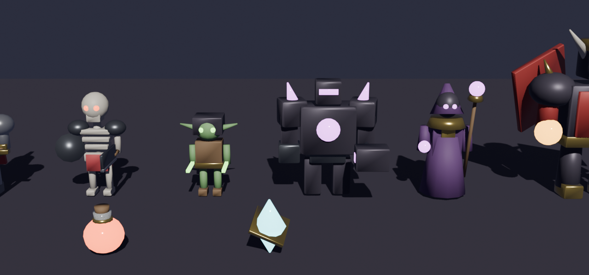
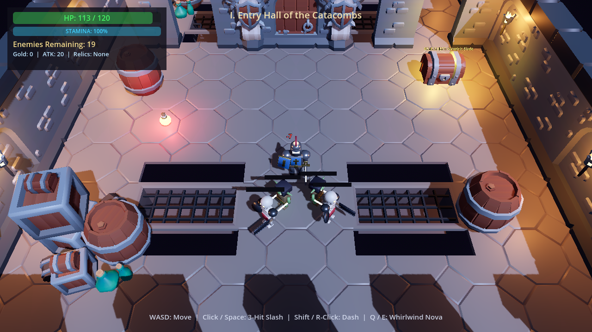
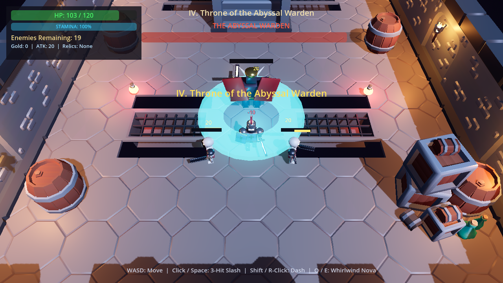

# Dungeon Crawler 3D — Godot 4.5

A **3D dark-fantasy action RPG dungeon crawler** built in **Godot 4.5** using custom **Blender MCP** character/boss models, **KayKit Dungeon Remastered** 3D architecture, and **ElevenLabs** voice acting, sound effects, and dungeon music.

🎮 **Play in Browser (GitHub Pages):** **[https://wolfxxx.github.io/DungeonCrawler/](https://wolfxxx.github.io/DungeonCrawler/)**

---

## 📸 Screenshots

| Blender 3D Cast (`models/*.glb`) | Entry Hall Combat | Throne of the Abyssal Warden |
| :---: | :---: | :---: |
|  |  |  |

---

## ⚔️ Features

- **3-Floor Procedural Dungeon Descent (12 Total Chambers)**:
  - **Floor 1 — *The Forgotten Catacombs*** (Warm torchlight • Boss: *The Abyssal Warden*)
  - **Floor 2 — *The Frostbitten Ossuary*** (Glacial cyan lighting • Boss: *Malakor, Archlich of Frost*)
  - **Floor 3 — *The Infernal Sanctum*** (Crimson-violet hellfire lighting • Final Boss: *Baelgor, Lord of the Abyss*)
  - Each floor consists of **4 interconnected 3D chambers (`80m × 20m`)** with hinged wooden doors that unseal and swing open as each chamber is cleared, culminating in a glowing **Descent Portal** at the North Grand Stairs.
- **RPG Level-Up & 3-Card Ascension Perk System**:
  - Earn XP from every monster and Soul Gem to level up and draft from **7 stackable build-defining perks**:
    - *Stormcaller's Arc* (Chain Lightning arcs between enemies on sword hit)
    - *Crescent Moon Wave* (3rd-hit combo launches a piercing energy wave projectile)
    - *Executioner's Edge* (+22% Critical Strike Chance & +0.45x Crit Damage)
    - *Tempest Step* (Dash unleashes a Thunder AoE shockwave + Move Speed)
    - *Bloodthirst Covenant* (Lifesteal on every sword strike + Max HP)
    - *Astral Supernova* (Chilling Frost Supernova on `Q`/`E` with reduced stamina cost)
    - *Titan's Resolve* (+45 Max HP, full heal, and +10/s Stamina Regen)
  - Includes **Combat-Safe Draft Queueing & `0.75s` Anti-Misclick Protection** so level-up cards never interrupt an active melee swing.
- **Mystic Dungeon Merchant & Gold Economy**:
  - Every enemy drops guaranteed **3D Gold Coin Stacks** (plus bonus Health Elixirs & Soul Gems).
  - Visit the **Mystic Merchant Stalls** in Chambers II & III (press **`F`**) to spend Gold on *Crimson Draught*, *Runeforged Edge*, *Arcane Conduit*, or *Tome of Ascension*.
- **Tactical Monster & Boss AI with 3D Wall Line-of-Sight**:
  - **Skeleton Executioner**: Raises a glowing **Buckler Shield Stance** that blocks frontal light slashes—flank behind or use `Q`/`E` Whirlwind Nova to break its guard.
  - **Shadow Goblin**: High-speed flanking, telegraphed ambush pounce, and hit-and-run evasive retreat.
  - **Obsidian Rune Golem**: Heavy juggernaut with telegraphed crimson AoE Ground Slam shockwaves.
  - **Cultist Necromancer**: Fires lead-predicted arcane bolt volleys and casts **Shadow Blink** when rushed.
  - **Floor Bosses**: Multi-attack bosses with Hellfire Meteor Rain AoEs, Dash Cleave charges, and 5-way orb fans.
- **Relic Chests, Breakable Props & 20 Custom ElevenLabs Audio Tracks (`sounds/*.mp3`)**:
  - Smash barrels and crates for loot, open **Golden Relic Chests** (*Vampiric Blade*, *Sunfire Brand*, *Dragonscale Plate*), and enjoy 15 custom SFX, 4 narrator voice lines, and a looping dark-fantasy soundtrack.

---

## 🎯 Controls

- **`W` `A` `S` `D` / Arrow Keys** — Move
- **Mouse Cursor** — Aim direction
- **`Left Click` or `Space`** — 3-Hit Rune Sword Combo
- **`Right Click` or `Shift`** — Arcane Dash (with invulnerability frames)
- **`Q` or `E`** — 360° Whirlwind Arcane Nova
- **`F`** — Open Mystic Merchant Shop / Descend Floor Portal
- **`TAB`** — Open queued Level-Up Perk Draft at any time
- **`1` / `2` / `3` / `4`** — Select Perk Card or Merchant Upgrade
- **`R`** *(on Victory / Defeat screen)* — Restart run
